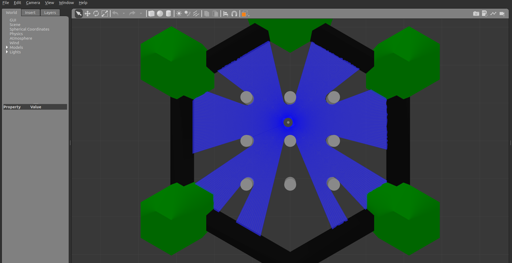
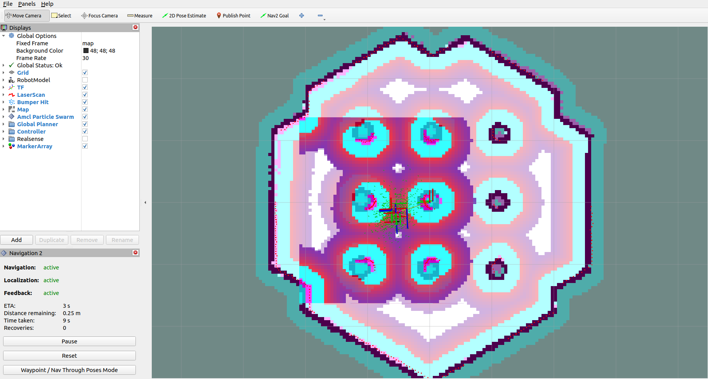

## RandomNav2Controller

RandomNav2Controller is a ROS 2 package that drives a TurtleBot3 to random
positions inside a configurable area using the Navigation 2 (Nav2) stack. It
uses Gazebo for simulation and the Nav2 simple commander API for navigation.

<p align="center">
    
    
</p>

### Features

- Set the robot's initial pose for localization
- Navigate to a specific pose programmatically
- Navigate continuously to random poses inside a configurable area
- Configure the goal area, initial pose, map frame, and navigation timeout with
  ROS 2 parameters

### Requirements

- Ubuntu 22.04 (Jammy Jellyfish)
- ROS 2 Humble
- Gazebo, Nav2, and TurtleBot3 packages

### Installation

Install the ROS 2 Humble binaries as described in the
[official ROS 2 documentation](https://docs.ros.org/en/humble/Installation.html),
then install the simulation and navigation dependencies:

```sh
sudo apt install ros-humble-gazebo-*
sudo apt install ros-humble-cartographer ros-humble-cartographer-ros
sudo apt install ros-humble-navigation2 ros-humble-nav2-bringup
sudo apt install ros-humble-nav2-simple-commander
sudo apt install ros-humble-turtlebot3-gazebo
sudo apt install ros-humble-dynamixel-sdk ros-humble-turtlebot3-msgs
sudo apt install ros-humble-turtlebot3
```

### Build

From the repository root:

```sh
source /opt/ros/humble/setup.bash
colcon build --packages-select turtlebot3_nav2
source install/setup.bash
```

### Usage

#### All-in-one launch (recommended)

Set the TurtleBot3 model and launch Gazebo, Nav2, and the controller together:

```sh
export TURTLEBOT3_MODEL=waffle
ros2 launch turtlebot3_nav2 turtlebot3_nav2_launch.py headless:=False
```

Use `use_rviz:=False` to skip RViz, or `headless:=True` to run Gazebo without
the graphical client.

#### Manual launch

Start the simulation and Nav2 in one terminal:

```sh
source /opt/ros/humble/setup.bash
export TURTLEBOT3_MODEL=waffle
export GAZEBO_MODEL_PATH=$GAZEBO_MODEL_PATH:/opt/ros/humble/share/turtlebot3_gazebo/models
ros2 launch nav2_bringup tb3_simulation_launch.py headless:=False
```

In another terminal, source the workspace and start the controller:

```sh
source /opt/ros/humble/setup.bash
source install/setup.bash
ros2 run turtlebot3_nav2 nav2_controller --ros-args -p use_sim_time:=true
```

The controller waits until Nav2 is active, sets the configured initial pose,
and then navigates to random goals until you stop it with `Ctrl+C`.

### Configuration

All parameters have defaults that match the original demo. Override them with
`--ros-args -p <name>:=<value>`.

| Parameter | Default | Description |
| --- | --- | --- |
| `frame_id` | `map` | Frame used for goal and initial poses |
| `initial_pose.x` | `-2.0437519550323486` | Initial pose X coordinate |
| `initial_pose.y` | `-0.5062426328659058` | Initial pose Y coordinate |
| `initial_pose.z` | `0.0` | Initial pose Z coordinate |
| `initial_pose.yaw` | `0.0` | Initial pose yaw in radians |
| `goal_area.min_x` | `-1.5` | Minimum random goal X coordinate |
| `goal_area.max_x` | `1.5` | Maximum random goal X coordinate |
| `goal_area.min_y` | `-1.5` | Minimum random goal Y coordinate |
| `goal_area.max_y` | `1.5` | Maximum random goal Y coordinate |
| `navigation_timeout_sec` | `600.0` | Timeout before a goal is canceled |

Example:

```sh
ros2 run turtlebot3_nav2 nav2_controller --ros-args \
  -p use_sim_time:=true \
  -p goal_area.min_x:=-1.0 \
  -p goal_area.max_x:=1.0 \
  -p goal_area.min_y:=-0.5 \
  -p goal_area.max_y:=0.5 \
  -p navigation_timeout_sec:=120.0
```

### Tests

Run the ROS 2 package tests and linters:

```sh
colcon test --packages-select turtlebot3_nav2
colcon test-result --verbose
```

The pure Python geometry and goal-sampling tests do not require ROS 2:

```sh
cd src/turtlebot3_nav2
python3 -m pytest test/test_geometry.py test/test_goal_sampler.py
```

### Troubleshooting

- **The controller waits at `Waiting for Nav2 to become active`**: start the
  Gazebo/Nav2 simulation first and check that the Nav2 lifecycle nodes are active.
- **TF or timestamp errors**: pass `-p use_sim_time:=true` when running against
  Gazebo.
- **Goals repeatedly time out**: check the Nav2 logs and make sure the goal area
  is reachable and inside the map.

### License

Apache-2.0. See [LICENSE](LICENSE).
